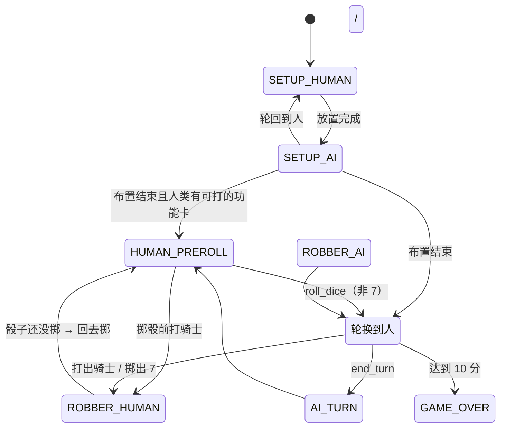

# ref · 项目架构总览（Catan / Godot 4.7）

> **本文性质**：参考性沉淀（`ref` 类，变体 B，免日期）。不对应某一次提交，描述的是**当前**代码的整体结构。
> 与本文互补的两份文档：
> - `AGENTS.md` —— 架构铁律、编码约定、已踩过的 16 个坑、提交前回归清单（**改架构必须同步它**）
> - `DESIGN.md` —— 权威设计文档与验收数据（棋盘几何、AI 参数出处、里程碑结论）
>
> 数据基准：41 个 `.gd` 文件 / 8495 行，其中生产代码（core+ai+game+ui）5404 行，`tools/` 3091 行。

---

## 1. 一句话定位

单机 **卡坦岛基础版**（1 人 + 2~3 档难度 AI），Godot 4.7 / GDScript，不联网，无第三方依赖。

它真正的工程目标不是"能玩"，而是：

> **AI 平衡性必须可验证**——规则引擎要能在无人值守下批量跑完整局，用胜率矩阵和守恒不变量说话。

这一条决定了后面所有的分层（见 §2 的"为什么这么切"）。

---

## 2. 分层总览

```
┌──────────────────────────────────────────────────────────────┐
│  scenes/main.tscn                                            │
│   Main(Node2D) ── BoardView ── HUD(CanvasLayer) ── GameDirector│
└──────────────────────────────────────────────────────────────┘
        │ 信号（点击 / 按钮）              ▲ 刷新（状态 → 界面）
        ▼                                  │
┌──────────────────────────────────────────────────────────────┐
│  ui/        BoardView · HUD · SafeArea · UIPalette            │
│             「哑」层：只画 / 只显示 / 只发信号，零规则判断     │
└──────────────────────────────────────────────────────────────┘
        │                                  ▲
        ▼                                  │
┌──────────────────────────────────────────────────────────────┐
│  game/      GameDirector · IntentProvider · HumanIntent       │
│             只回答「现在该谁、用哪种交互」，不做规则判断       │
└──────────────────────────────────────────────────────────────┘
        │ 决策请求                          ▲ 状态
        ▼                                  │
┌──────────────────────────────────────────────────────────────┐
│  ai/        AIController(+Easy/Medium/Hard) · Evaluation      │
│             实现 IntentProvider；三档差异 = 参数 + 少量钩子    │
└──────────────────────────────────────────────────────────────┘
        │ 想做什么（Dictionary）             ▲ 只读 GameState
        ▼                                  │
┌──────────────────────────────────────────────────────────────┐
│  core/      GameController（回合调度 / 状态机 / 胜负）        │
│             Rules（**全部**合法性判断，纯函数）                │
│             GameState · PlayerState · Board · BoardTopology    │
│             LongestRoad · HexGrid · Res（常量表）             │
│             ⚠️ 全是 RefCounted，不碰 Node / UI，headless 可跑 │
└──────────────────────────────────────────────────────────────┘
```

**依赖方向是单向向下的**：`ui` → `game` → `ai` → `core`。`core` 不认识任何上层。

### 为什么这么切

| 约束 | 带来的设计 |
|---|---|
| AI 平衡要能批量验证 | `core/` 必须 headless 可跑 → 禁 Node / 禁 UI 依赖 |
| 人类与 AI 走同一套规则 | 两者都实现 `IntentProvider`，`GameController` 不区分人机 |
| AI 要"假设性推演" | 所有合法性判断收进 `Rules`，且必须是**纯函数** |
| 界面与批量验收不能各写一套 | `GameController` 做成可分步驱动，`run()` 只是同一个 API 的循环包装 |
| 拓扑只算一次 | `BoardTopology.instance()` 缓存，几何错了全局污染 → 配 `self_check()` 硬断言 |

---

## 3. 目录与模块职责

```
core/    纯逻辑，禁止 Node/UI 依赖（headless 必跑）  1691 行
  hex_grid.gd         axial 坐标 + 顶点像素化生成；19 地块的 3-4-5-4-3 布局
  board_topology.gd   19 地块 / 54 顶点 / 72 边 + 全部邻接表；单例缓存 + self_check()
  board.gd            岛屿生成（地形洗牌 / 数字拒绝采样 / 9 个港口）+ 自检
  game_state.gd       全局状态快照：银行、骰子、强盗、回合、日志、两大奖励归属
  player_state.gd     单玩家状态：资源、建筑、发展卡、胜负分
  game_controller.gd  回合调度 / 动作执行 / 奖励裁定 / 胜负 + 无人值守 run()
  rules.gd            **全部**合法性校验，纯函数
  longest_road.gd     最长道路：顶点简单路径 DFS
  resources.gd        常量总表：资源/地形/发展卡/港口/花费/上限/动作类型

ai/      AI 决策层                                    760 行
  ai_base.gd          AIController：共享评分 + IntentProvider 实现 + 9 个可调参数
  ai_easy/medium/hard.gd  三档：只改参数，Hard 额外覆写 2 个钩子
  evaluation.gd       评分函数库：顶点产出期望、阶段权重、威胁度

game/    交互编排                                      606 行
  game_director.gd    7 状态机：谁行动、用哪种交互、AI 定时推进
  intent_provider.gd  人机共用决策接口（只读 GameState，返回"想做什么"）
  human_intent.gd     人类座位占位：只兜底"来不及问玩家"的时机

ui/      表现层（全部代码搭控件，不手写 .tscn）        2247 行
  board_view.gd       棋盘 _draw() 手绘 + 命中测试 + 图例 + 港口牌
  hud.gd              右侧面板：玩家行 / 操作区 / 银行兑换弹窗 / 发展卡弹窗 / 事件日志
  safe_area.gd        DisplayServer 安全区 → 视口 inset（Vector4）
  palette.gd          玩家色 / 资源色 / 资源短名（两边共用一份）

scenes/  main.tscn —— 只有 4 个节点，脚本挂上去即可（F5 直跑）
tools/   20 个 CLI 脚本：10 个 headless 测试 + 6 个渲染依赖 + 3 个探针 + 1 个裁图
assets/  terrain/（派生缩小版，游戏用）· resource.src/（原图只读，.gdignore）
docs/    board_preview.png + 三张 gameplay 截图
```

---

## 4. 状态模型

```
GameState ─┬─ board: Board ────────── hex_terrain[19] / hex_number[19] / vertex_port[54] / robber_hex
           │                          （生成期：地形洗牌 → 数字拒绝采样 → 港口按海岸环均匀取 9 条边）
           ├─ players: [PlayerState]  resources[5] / settlements / cities / roads / dev_cards
           ├─ bank[5]                 每种 19 张；产出时 bank_take，花费时 bank_give
           ├─ dev_deck[25]            14 骑士 / 5 胜利点 / 2 修路 / 2 丰收 / 2 垄断
           ├─ 回合标记                 current · round · dice · dice_rolled · dev_played_this_turn
           ├─ 待办标记                 pending_robber · free_roads_remaining
           ├─ 初始布置                 setup_order（蛇形 0 1 2 3 3 2 1 0）· setup_index · setup_stage · setup_anchor
           ├─ 奖励归属                 longest_road_owner / largest_army_owner
           └─ log_lines               事件日志（跨局延续，只增不减）
```

几条容易踩的状态约定（都写在代码注释里）：

- **`dice_rolled` 而不是 `dice == 0`** 判断"本回合掷没掷"。上一回合的点数会残留；掷骰前打骑士触发的强盗，放完必须回到"掷骰前"状态，靠的就是这个布尔位。
- **胜利点卡不打出自计分**，AI 看局势只能用 `public_victory_points()`（不含暗牌），避免作弊式信息。
- **银行是有限牌库**（每种 19 张）。耗尽后不再产出，这是官方规则，也是 `sim_runner` 守恒不变量的基石。
- **拓扑是全局单例** `BoardTopology.instance()`，构建一次后复用；任何几何改动先跑 `verify_topology.gd`。

### BoardTopology 的生成方式

不手写邻接表，而是 **"算出所有地块角点的像素坐标 → 按坐标取整合并"** 得到共享的顶点/边。19/54/72 的共享关系由几何自动保证，抄不错。
`self_check()` 除了规模，还断言度数分布：顶点邻接地块数 18/12/24（`n3 - n1 = 6·HEX − 2·VERTEX = 6`），边邻接地块数 30（外缘）/42（内部）。

---

## 5. 规则层：`Rules`（core/rules.gd）

**全部**合法性判断集中在这里，且都是 `static func`（不改状态）。分类：

| 类别 | 函数 |
|---|---|
| 占位查询 | `building_owner` / `road_owner` / `occupancy_map` / `road_map` |
| 建造校验 | `distance_rule_ok`（距离规则）· `vertex_connected_to_network`（连路网）· `valid_settlement_vertices` / `valid_road_edges` / `valid_city_vertices` |
| 资源与交易 | `can_afford` / `best_ratio_for`（2/3/4）· `can_bank_trade` / `bank_trade_options` |
| 发展卡 | `can_buy_dev` / `playable_dev_cards` / `monopoly_yield` / `monopoly_breakdown` |
| 强盗与弃牌 | `valid_robber_hexes` / `steal_candidates` / `discard_count`（≥8 弃一半，向下取整） |

> ⚠️ **`Rules` 只判"合法"，不判"买得起"。** UI 高亮必须自己再叠一层 `p.has(COST_*)`，否则玩家能点一堆没反应的空位（实测踩过）。

---

## 6. 回合调度：`GameController`

同一套 API 支撑两种用法——**这是整个架构的枢纽**：

```gdscript
# ① 无人值守批量跑（sim_runner / M1 验收）
ctl.new_game(configs, seed, beginner, providers)
ctl.run(300)              # → st.winner

# ② 交互式分步驱动（GameDirector / 界面）
ctl.new_game(...)
while not ctl.setup_is_over():      # 初始布置
    ctl.setup_pid() / ctl.setup_valid_spots() / ctl.setup_apply(spot)
while not ctl.st.is_over():         # 主循环
    ctl.begin_turn()                # = start_turn() + roll_dice()
    ctl.apply_action(pid, action)   # 反复调用，返回 false 表示非法（状态不变）
    ctl.finish_turn()
    ctl.advance_player()
```

要点：

- **`begin_turn()` = `start_turn()` + `roll_dice()`**，拆两步是为了给人类留"掷骰前打骑士"的官方时机。⚠️ **RNG 调用顺序必须与合体版一字不差**，否则 `sim_runner` 的胜率矩阵会悄悄换含义——`test_dev_dialog.gd` 专门断言两条路径的骰子序列一致。
- **`apply_action()` 非法即返回 `false` 且不改状态**，所以最笨的 AI 也跑不崩对局；上层收到 `false` 会 `notify_invalid()`，AI 把该动作拉黑后重试（同一回合最多 4 次，然后强制结束回合）。
- 动作是 `Dictionary`，`type` 取 `Res.A_*` 常量（建村/修路/升城/买卡/打卡/银行兑换/提议交易/结束回合）。
- 落子后自动重算：最长道路（`LongestRoad.update_owner`）、最大军队（≥3 骑士，并列时持有者保留）。
- 胜负：`victory_points() >= 10`；`run()` 超回合上限则按公开分取最高（平局记 -1）。

### 最长道路为什么用"顶点简单路径"

把顶点当节点、路当边，求**顶点不重复的**最长路径。若按"共享顶点即连通"建图，三条路交于一点会被算成一条 5 段的路，但几何上那条中间的路必须原路折返——不成立。简单路径天然排除折返，并顺带正确处理两个官方裁决：绕一整圈 = 5 段；对手村庄所在顶点可作为终点但不可穿过。

---

## 7. AI 层

### 接口契约：`IntentProvider`

```gdscript
choose_initial_settlement / choose_initial_road     # 初始布置
choose_discard / choose_robber_hex / choose_steal_target   # 弃牌 / 强盗
choose_action(st) -> Dictionary                     # 主阶段"下一步做什么"
respond_trade(st, offer) -> bool                    # 别人向我提议
on_game_start / on_turn_start / on_invalid_action / on_game_end   # 生命周期回调
```

约定：**只读 `GameState`，返回"想做什么"，绝不直接改状态**。控制器负责校验 + 执行。

### 决策流程（`AIController.choose_action`）

不是"if-else 优先级链"，而是 **候选 + 打分 + 排序**：

1. 按当前阶段取资源权重（`Evaluation.weights_for`，早期木砖贵 / 后期麦矿贵）
2. 生成候选并各自打分：打发展卡 → 免费道路(500) → 升城(100·city_bias) → 建村(99·settle_bias + 顶点分) → 买卡(72·dev_bias) → 修路(`_edge_score`) → 银行交易(130) → 主动提议交易
3. 每个候选叠 `+_noise()`（评分噪声，随难度递减）
4. `sort_custom` 取最高分；`best.erase("score")` 后交给控制器

> 银行交易必须是**有分数的候选**（130），不能塞进"无事可做"的兜底分支——否则 AI 永远有便宜路可修，这个分支永远轮不到。

### 三档难度的差异来自"决策质量"，不是数值缩放

| 参数 | Easy | Medium | Hard | 含义 |
|---|---|---|---|---|
| `noise` | 28 | 7 | 0 | 评分噪声 |
| `savvy` | 0.2 | 0.55 | 1.0 | 针对性：强盗打击 / 偷牌 / 冲最长路 / 谈判风险 |
| `trade_risk` | 0.6 | 1.6 | 2.6 | 对"喂养对手"的警惕度 |
| `random_accept` | 0.35 | 0 | 0 | 不看条件就接受交易的概率 |
| `pass_chance` | 0.10 | 0 | 0 | 提前结束回合 |
| `max_offers_per_turn` | 0 | 0 | 1 | 主动发起交易 |
| `*_bias` | <1 | ≈1 | >1 | 各类建造倾向 |

Hard 额外覆写两个钩子：`_extra_settlement_bonus`（抢对手路端点、占领先者旁边的地）和 `_extra_road_bonus`；Easy 额外覆写 `choose_action`（6% 概率"忘了还能干活"直接过）。

**加一档难度 = 加一个 `AIController` 子类**，调度代码一行不改。

### 评分地基：`Evaluation`

```
顶点价值 = Σ(pip 值 × 资源权重) + 资源多样性加成(3) + 港口加成(通用 6 / 指定 12) − 被堵惩罚
资源权重三档：EARLY [1.15,1.15,0.90,1.00,0.80] → LATE [0.85,0.85,1.00,1.20,1.25]
```

- **道路按"新打通了哪个顶点"定价**，不能按"沿线顶点产出总和"——后者会让路的分值和城市同量级，AI 会疯狂修路不升城。
- 阶段判断用**公开分**估算，AI 不偷看别人的暗牌。

### 人类座位：`HumanIntent`

真正的"我想建什么"由界面直接调 `apply_action()` 提交，**不经过 IntentProvider**。`HumanIntent` 只兜底三类来不及问的时机：弃牌（贪心自动弃）、强盗落点/偷牌（合理默认）、别人提议交易（自动拒绝但写进日志）。

---

## 8. 交互编排：`GameDirector`（7 状态机）



- **`_process()` 只驱动 AI 状态**（`SETUP_AI` / `ROBBER_AI` / `AI_TURN`，带 `ai_delay` 停顿）；人类状态一律等点击。
- **`HUMAN_PREROLL` 是官方规则的产物**：掷骰前允许打功能卡，此时**不能建造、不能交易、不能结束回合**，棋盘 `Pick.NONE`。
- **`_update_highlights()` 同时判"合法"和"买得起"**，并据此切换 `Pick` 模式（布置村庄=VERTEX / 布置道路=EDGE / 放强盗=HEX / 主阶段=ANY）。
- **刷新三件事分开传**：`can_act`（能不能操作）、`main_phase`（掷没掷骰、能否建造交易）、`preroll`。掷骰前"能操作"但"不能建造"，混成一个布尔就会出现"产出前偷建"。
- `auto_play = true`（或命令行带 `auto`）时把人类座位也交给 `AIMedium`——截图脚本和回归测试靠这个跑完整局。

---

## 9. 表现层

### BoardView（`Node2D`）

- **静态棋盘用 `_draw()` 手绘**，不给 19/54/72 建节点树。贴图走 `draw_polygon(points, colors, uvs, texture)`；UV 必须从多边形的**像素包围盒**推导。
- 逻辑层用"地块半径 = 1"的世界单位，渲染统一 × `px_per_unit` 再平移到 `board_origin`；命中测试反向换算。
- 全部可调项都是 `@export`（种子、缩放、原点、显示开关、图例开关）。
- **`Pick.ANY` 是顶点优先**，不是"谁离鼠标更近谁赢"。`PICK_VERTEX_R = 0.40`（≈25px，按手指定尺寸）。
- 画在棋盘之上的浮层（图例）**必须同时吃掉点击**（`_hit_legend()`），否则"想看图例却建了座村庄"。
- 港口牌：通用 3:1 写 `?`，指定港写一个字（木/砖/羊/麦/矿）；牌心 = 边中点沿**该边外法线**外推（用径向会横向偏最多 24px）。

### HUD（`CanvasLayer`）

- 右侧面板 **全部代码搭控件**（按钮随状态增删，手写 `.tscn` 维护不动）。
- **只显示 + 发信号**，判断全在 `GameDirector`。信号：`end_turn_pressed` / `buy_dev_pressed` / `play_dev_pressed(card,r,r1,r2)` / `bank_trade_pressed(give,take)` / `roll_dice_pressed` / `new_game_pressed(diffs)`。
- 四个弹窗：开局/重开（**逐 AI 难度，没有种子输入**——棋盘每局由 `GameDirector` 随机）/ 银行兑换 / 发展卡（含垄断选资源、丰收选 2 张）/ 日志（仅竖屏）。
- 开局弹窗在**开局前自动弹出**（`auto` 演示模式跳过），`HUD.show_idle()` 负责把弹窗背后那张"还没开局"的空面板收拾干净。
- 事件日志**全量保留**、跨局延续；自动滚动只在玩家已停在底部时触发。
- 面板贴**视口右缘**（不写死 x），宽屏/横屏自适应。

### SafeArea / UIPalette

- `SafeArea.insets() -> Vector4(左,上,右,下)`，读 `DisplayServer` 真实安全区，单位视口逻辑像素；`MIN_*` 兜底**只在 mobile 生效**（否则桌面布局漂移、截图基准全废）。`set_override()` 可在桌面注入手机横屏值预览。
- 消费 inset 的算式抽成**静态纯函数**（`BoardView.board_origin_for` / `HUD.content_rect`），headless 可测。
- `UIPalette` 是唯一的配色源头（玩家色、资源色、资源短名），棋盘和面板共用一份。

---

## 10. 工具链与验收（`tools/`，20 个脚本）

| 类别 | 脚本 | 说明 |
|---|---|---|
| headless 测试 | `verify_topology` | 19/54/72 + 度数分布硬断言 |
| | `test_rules` | 46 条规则单测 |
| | `test_trade_dialog` / `test_dev_dialog` | 24 / 56 条（含 `begin_turn` 与 `start_turn+roll_dice` 骰子序列一致） |
| | `test_setup_dialog` | 25 条：开局弹窗逐 AI 难度互斥/回填、**弹窗内不许有输入框**、回车/Esc |
| | `test_seed` / `test_pick` / `test_safe_area` / `test_legend` / `test_ports` | 生成规则、触屏命中、安全区、图例、港口摆位 |
| | `sim_runner` | 批量对局 + 胜率矩阵；**强制校验**：棋盘合法 / 资源守恒（银行+玩家 = 每张 19）/ 状态完整性 |
| 渲染依赖（**禁 headless**） | `screenshot` / `shot_dialog` / `shot_trade_dialog` / `shot_dev_dialog` / `shot_help` / `test_interaction` | 走真实渲染器；`--headless` 会挂在 `frame_post_draw` 上被 kill（exit 137 且无输出）。涉及鼠标坐标的必须 `--resolution 1280x720` |
| 只读探针 | `probe_seed` / `probe_legend` / `probe_ports` | 打印中间量，比截图便宜 |
| 辅助 | `crop_shot` | 裁图 + 最近邻放大，20px 级细节（港口牌、图例小字）**必须靠它看** |

> ⚠️ 贴图有没有生效**不能靠眼睛**（贴图与纯色块颜色接近时完全分不出）→ 看 `screenshot.gd` 输出的 `地形贴图: N/6`。

---

## 11. 关键设计决策（Why）

| 决策 | 理由 |
|---|---|
| `core/` 禁 Node/UI | 让规则引擎 headless 跑 500 局，AI 平衡才有客观数据 |
| 人机共用 `IntentProvider` | 加难度不动调度；批量验收与交互游戏天然同一条代码路径 |
| `Rules` 全静态纯函数 | AI 需要"假设性推演"；纯函数可反复调用不改状态 |
| 拓扑单例 + `self_check()` | 几何错一处会静默污染全局，必须硬断言 |
| `_draw()` 手绘棋盘 | 静态内容，一次性绘制比维护上百节点轻；命中测试用几何算 |
| 界面与 AI 共用分步 API | 避免"测试专用第二实现"，那必然与真实路径漂移 |
| 生成失败 `push_error` | 旧实现"洗牌+重试 2000 次"失败后静默保留非法盘，41% 的图违规且无日志 |
| 只守官方规则 | 6/8 不相邻 + 相邻不同数字（`beginner=true`）；**地形/资源相邻无任何官方限制**。"同资源不相邻"是民间口味，曾误加后被删除，`test_seed.gd` 反向断言它必然出现 |
| 道路按"新打通的顶点"定价 | 按沿线产出定价会让路与城同量级 → AI 疯狂修路不升城 |
| 高亮色用青色 | 绿色在森林/牧场上看不见，白色在沙漠/麦田上消失 |

---

## 12. 架构铁律（速查，完整版见 `AGENTS.md`）

1. `core/` 绝不依赖 Node / UI，必须 headless 可跑。
2. 人机共用 `IntentProvider`；加难度 = 加子类，不动调度。
3. 合法性判断只在 `Rules`，且必须是纯函数。
4. `GameController` 分步可驱动；界面与批量共用同一条路径，禁止写第二套。
5. `GameDirector` 只管"该谁、怎么交互"，不做规则判断。
6. HUD 是哑的：显示 + 发信号；控件代码生成。
7. 拓扑算一次并缓存；动几何必跑 `verify_topology.gd`。
8. 改规则必跑 `test_rules.gd` + `sim_runner.gd`，并**报数字**（胜率、违规数），不能只说"能跑"。

---

## 13. 当前进度

- **已完成**：P0 脚手架 · P1 拓扑 · P2 规则引擎 · P3 三档 AI · P4 棋盘渲染 · P5 玩家交互
- **已验收**：M1（规则引擎）、M2（人类 vs 3 AI 完整一局）
- **进行中（M3）**：交易与发展卡弹窗化、横屏宽屏自适应、图例折叠 + 手机安全区、图例第二列"建造花费"、港口牌改单字
- **待做**：弃牌/丰收年让玩家自选、玩家间交易 UI、动画音效、教程、存档、设置页

验收数据与逐日进展：见 `DESIGN.md`（中文）、`.workbuddy/memory/` 下的每日日志，以及本目录的 `project-*` / `changed-*` 归档。
